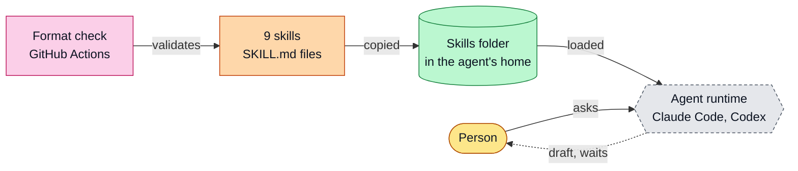
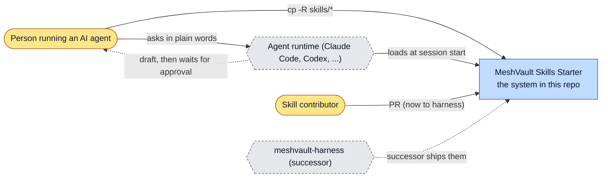
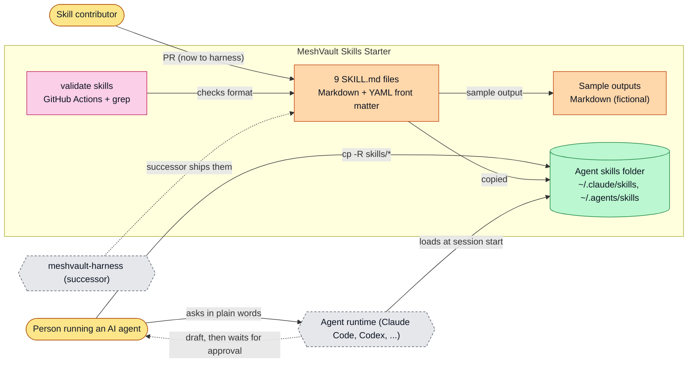
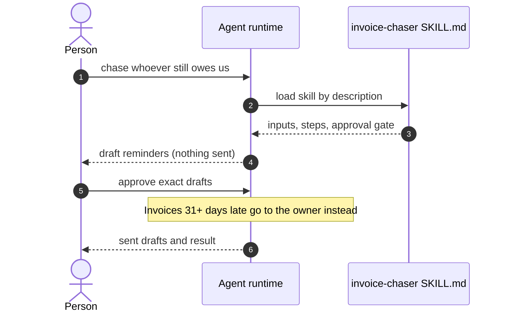
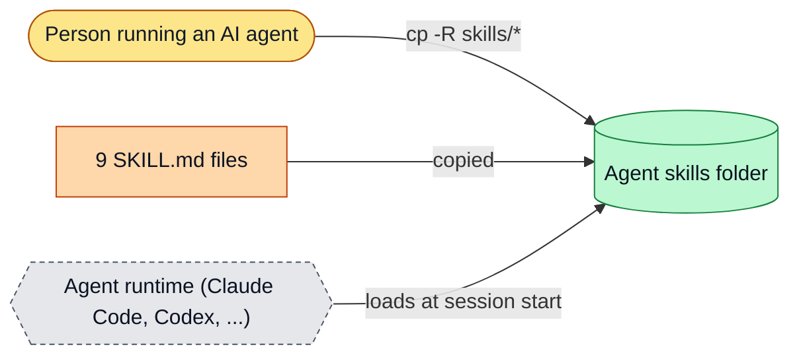
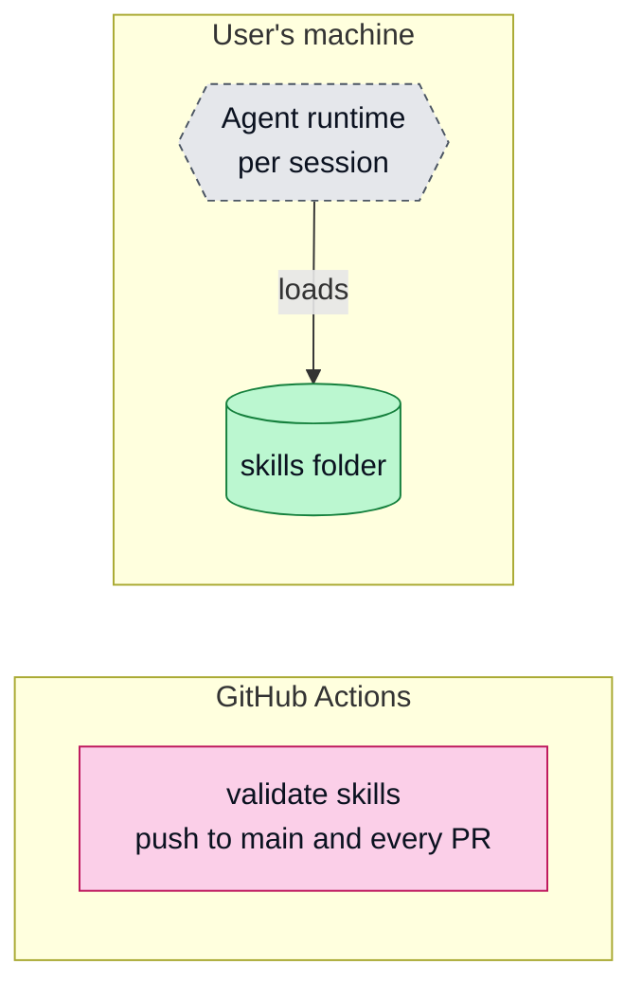

# MeshVault Skills Starter: architecture

<!-- arch-kit:generated -->

> Whiteboard-level structure: what systems exist, what they talk to, and when they run. Evidence-backed; every box below maps to a path listed in [Evidence](#10-evidence).
> Generated by the ArchDocs kit from repo commit `bb622e7e0e`. Diagram sources: [`architecture/*.mmd`](architecture/). Hi-res renders sit next to each source.

## 1. Purpose

MeshVault Skills Starter is nine MIT-licensed agent skills for small-business admin work: chasing invoices, drafting quotes, filing receipts, triaging email and prepping meetings. Each skill is one `SKILL.md` that Claude Code, Codex or any loader of skill folders can read. Every skill tells the agent to stop and wait for a person before it sends, pays, posts, moves files or deletes. There is no code and no enforcement: the approval gate is an instruction to the model. Active development moved to meshvault-harness; this repo stays up for existing links.

## 2. Whiteboard view

Five boxes. The repo is text; the approval gate lives in the model's instructions, not in code.

Hi-res: [SVG](architecture/whiteboard.svg) · [PNG 3x](architecture/whiteboard@3x.png) · [dark SVG](architecture/whiteboard.dark.svg) · [dark PNG 3x](architecture/whiteboard.dark@3x.png)

Explorable version (Archify, standalone HTML, download and open locally): [`architecture/meshvault-skills-starter.archify.html`](architecture/meshvault-skills-starter.archify.html)

## 3. System context (C4 level 1)

Who and what touches the system from outside.

Hi-res: [SVG](architecture/context.svg) · [PNG 3x](architecture/context@3x.png)

## 4. Containers and components (C4 level 2)

The parts that run or hold data inside the repo's system boundary.

Hi-res: [SVG](architecture/containers.svg) · [PNG 3x](architecture/containers@3x.png)

| Container | Kind | Tech | What it does | Evidence |
|---|---|---|---|---|
| 9 SKILL.md files | doc | Markdown + YAML front matter | Required Inputs, Steps, Approval Gate, Output. License MIT, version 1.0.0. | [`skills/invoice-chaser/SKILL.md`](../skills/invoice-chaser/SKILL.md), [`README.md#L55-L65`](../README.md#L55-L65) |
| Sample outputs | doc | Markdown (fictional) | Sample output for invoice-chaser, inbox-triage, daily-standup. | [`examples/invoice-chaser-sample.md`](../examples/invoice-chaser-sample.md), [`examples/README.md`](../examples/README.md) |
| validate skills | job | GitHub Actions + grep | Fails if a skill lacks name, description, license: MIT, or an Approval Gate section. | [`.github/workflows/validate.yml#L14-L24`](../.github/workflows/validate.yml#L14-L24) |
| Agent skills folder | store | ~/.claude/skills, ~/.agents/skills | Where the user copies skills so the runtime loads them. | [`README.md#L30-L35`](../README.md#L30-L35) |

## 5. Key runtime sequences

### 5.1 A skill runs with its approval gate

Hi-res: [SVG](architecture/sequence-1.svg) · [PNG 3x](architecture/sequence-1@3x.png)

## 6. Data flow and stores

How data moves between components and where it rests.

Hi-res: [SVG](architecture/dataflow.svg) · [PNG 3x](architecture/dataflow@3x.png)

## 7. Deployment and runtime topology

No servers. The only automation is the format check in GitHub Actions.

Hi-res: [SVG](architecture/deployment.svg) · [PNG 3x](architecture/deployment@3x.png)

| What | Where | Runs when | Trigger / port | Evidence |
|---|---|---|---|---|
| validate skills | GitHub Actions | Every push to main and every pull request | .github/workflows/validate.yml | [`.github/workflows/validate.yml#L2-L4`](../.github/workflows/validate.yml#L2-L4) |

## 8. Failure modes and how to see them

| Failure | What the user sees | How to see it | Evidence |
|---|---|---|---|
| Agent ignores the Approval Gate | It can send, pay or delete if it has the access | Keep the agent's own approval settings on; the gate is an instruction, not a block | [`README.md#L11`](../README.md#L11) |
| cp -R overwrites a same-named skill | Local edits lost | Copy single folders instead | [`README.md#L28`](../README.md#L28) |
| Skill missing a required key or gate section | CI fails | `MISSING ...` lines in the validate job log | [`.github/workflows/validate.yml#L19-L22`](../.github/workflows/validate.yml#L19-L22) |

## 9. State machine

No state machine in this repo: skills are static files.

## 10. Evidence

Every path below exists at the pinned commit; links are relative to `docs/`.

| Path | Why it matters |
|---|---|
| [`skills/invoice-chaser/SKILL.md`](../skills/invoice-chaser/SKILL.md) | Representative skill: inputs, steps, approval gate, output. |
| [`.github/workflows/validate.yml`](../.github/workflows/validate.yml) | The only automation: format and approval-gate check. |
| [`README.md#L55-L65`](../README.md#L55-L65) | Skill file format and the three rules behind every skill. |
| [`SECURITY.md`](../SECURITY.md) | States that the gate is an instruction, not enforcement. |
| [`examples/README.md`](../examples/README.md) | Fictional sample outputs. |

Collected mechanically by the kit ([`architecture/facts.json`](architecture/facts.json), not hand-edited):

- CI: `.github/workflows/validate.yml`

Graphify (local AST, no LLM) read this repo: 98 nodes, 93 edges, 15 communities. Most connected: `MeshVault Skills Starter` (9), `Install` (7), `AGENTS.md: MeshVault free skills and the $49 pack` (6), `Agents on Device` (5), `Client Follow-Up` (5).

- Report: [`architecture/graphify/GRAPH_REPORT.md`](architecture/graphify/GRAPH_REPORT.md)
- Interactive graph: [`architecture/graphify/graph.html`](architecture/graphify/graph.html) (82 KB, download and open locally)
